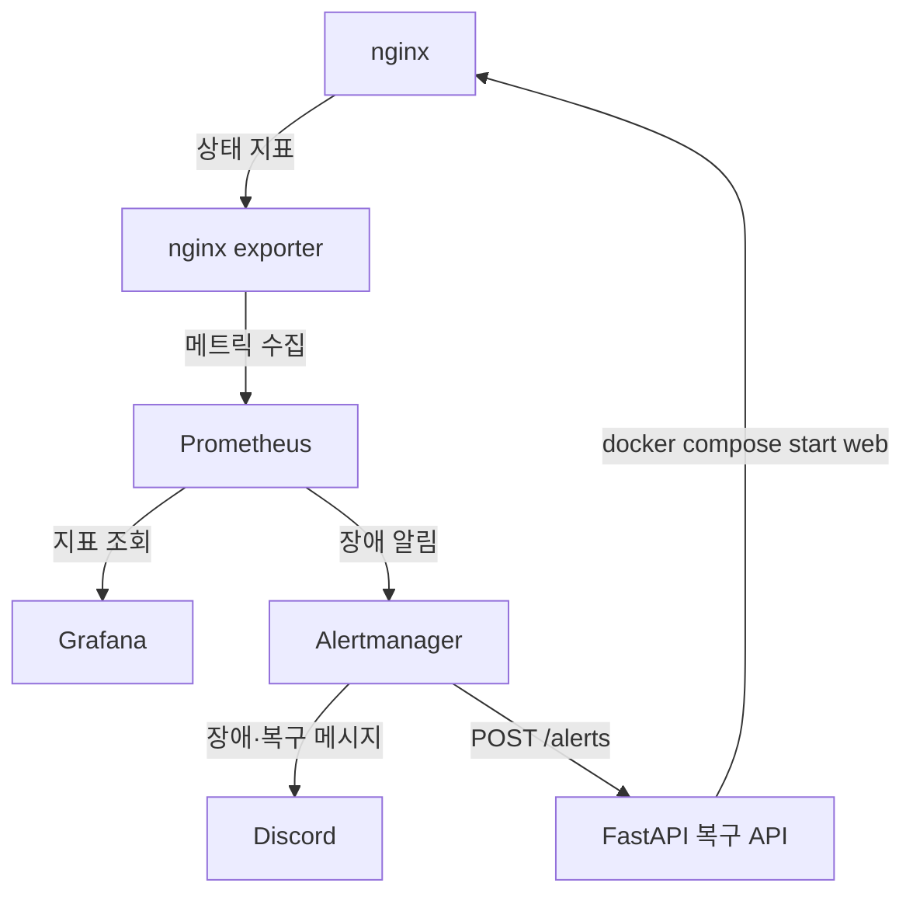

# SDDAR — nginx 장애 감지 및 자동 복구

nginx 장애를 Prometheus로 감지하고, Alertmanager가 Discord 알림과
복구 API 호출을 수행하는 로컬 실습 프로젝트다.

Grafana로 서비스 상태를 시각화하고, 장애 발생부터 자동 복구까지의
흐름을 직접 검증했다.

## 구성



- nginx exporter: nginx의 `/nginx_status`를 조회한다.
- Prometheus: 지표를 수집하고 `NginxDown` 규칙을 평가한다.
- Alertmanager: 장애 알림을 Discord와 복구 API로 전달한다.
- Grafana: nginx 상태, 초당 요청 수, 현재 연결 수를 표시한다.
- 복구 API: WSL에서 실행하며 조건에 맞는 알림을 받아 nginx를 시작한다.

## 실행 환경

실습에서 사용한 환경:

- Windows + WSL2 Ubuntu
- Docker Desktop 및 Ubuntu WSL 연동
- Docker Engine 29.9.2
- Python 3.14 및 venv
- Discord 서버와 웹후크

복구 API는 컨테이너가 아닌 WSL에서 실행한다.
Alertmanager는 `host.docker.internal:8001`을 통해 접근한다.
다른 Docker·네트워크 환경에서는 연결 설정을 조정해야 할 수 있다.

## 실행 방법

아래 명령은 저장소 루트에서 실행한다.

### 1. Discord 웹후크 파일 준비

`.gitignore`에 `/secrets/`가 등록되어 있는지 확인한다.
웹후크 주소는 Git에 커밋하지 않는다.

```bash
mkdir -p secrets
read -rsp "Discord 웹후크 URL: " DISCORD_WEBHOOK_URL
echo
printf '%s' "$DISCORD_WEBHOOK_URL" > secrets/discord-webhook-url
unset DISCORD_WEBHOOK_URL

git check-ignore secrets/discord-webhook-url
```

마지막 명령에서 `secrets/discord-webhook-url`이 출력되는지 확인한다.

### 2. Python 환경 준비

```bash
python3 -m venv .venv
source .venv/bin/activate
python -m pip install -r requirements.txt
```

Ubuntu에서 ensurepip 관련 오류가 나면, 설치된 Python 버전에 맞는
venv 패키지가 필요하다. 이 실습에서는 `python3.14-venv`를 사용했다.

### 3. 설정 검사

```bash
docker compose config -q

docker compose run --rm --no-deps --entrypoint promtool prometheus \
  check config /etc/prometheus/prometheus.yml

docker compose run --rm --no-deps --entrypoint amtool alertmanager \
  check-config /etc/alertmanager/alertmanager.yml
```

### 4. 복구 API 실행

터미널 1에서 실행하고 켜 둔다.

```bash
.venv/bin/python -m uvicorn recovery:app --host 0.0.0.0 --port 8001
```

현재 API에는 인증이 없다. 로컬 실습용이며 외부에 공개하지 않는다.

### 5. 컨테이너 실행

같은 프로젝트의 터미널 2에서 실행한다.

```bash
docker compose up -d
docker compose ps
```

컨테이너에서 복구 API까지 연결되는지 확인한다.

```bash
docker compose exec -T prometheus wget -T 5 -O /dev/null \
  http://host.docker.internal:8001/openapi.json
```

### 6. 화면 접속

| 서비스 | 주소 |
|---|---|
| nginx | http://localhost:8080 |
| Prometheus | http://localhost:9090 |
| Alertmanager | http://localhost:9093 |
| Grafana | http://localhost:3000 |

Grafana 최초 로그인은 `admin` / `admin`이며 로그인 후 비밀번호를 변경한다.

Grafana 데이터 소스에 Prometheus를 추가한다.

- Prometheus server URL: `http://prometheus:9090`
- Save & test로 연결 확인

Grafana의 대시보드 Import 기능에서 다음 파일을 불러온다.

`monitoring/grafana/nginx-dashboard.json`

가져오기 후 각 패널이 등록한 Prometheus 데이터 소스를 사용하는지 확인한다.

## 모니터링과 알림

| 지표·쿼리 | 의미 |
|---|---|
| `up{job="nginx"}` | Prometheus가 exporter 메트릭을 정상 수집했는지 |
| `nginx_up` | exporter가 nginx 상태를 정상 조회했는지 |
| `rate(nginx_http_requests_total[1m])` | 최근 1분 기준 초당 평균 요청 수 |
| `nginx_connections_active` | 현재 활성 연결 수 |

exporter가 살아 있다면 nginx가 중지되어도 `up{job="nginx"}`는
1일 수 있다. nginx 상태는 `nginx_up`으로 별도 확인한다.

장애 규칙:

- 알림 이름: `NginxDown`
- 조건: `nginx_up == 0`
- 유지 시간: `30s`

실제 알림 시점에는 수집 주기, 규칙 평가 주기,
Alertmanager의 대기 시간도 영향을 준다.

## 자동 복구 검증

복구 API가 실행 중인 상태에서 nginx만 중지한다.

```bash
docker compose stop web
```

직접 시작 명령을 실행하지 않고 다음 흐름을 확인했다.

1. Prometheus에서 `NginxDown`이 Firing으로 전환
2. Alertmanager가 복구 API에 `POST /alerts` 전송
3. 복구 API가 `docker compose start web` 실행
4. 명령 종료 코드 0 및 nginx HTTP 200 확인
5. Discord에서 RESOLVED 메시지 수신

HTTP 확인 명령:

```bash
curl -I --max-time 5 http://localhost:8080/
```

## 복구 API 처리 방식과 검증 결과

`status`가 `firing`이고 `alertname`이 `NginxDown`인 알림만 처리한다.
명령은 고정된 인자 목록으로 실행하며 요청에서 실행 명령을 받지 않는다.

| 조건 | 확인한 결과 |
|---|---|
| 최초 장애 요청 | nginx 시작 명령 실행 |
| 같은 fingerprint와 startsAt 재전송 | 성공 기록이 있으면 명령 생략 |
| fingerprint는 같고 startsAt이 다른 요청 | 새 장애로 판단해 명령 실행 |
| 존재하지 않는 서비스로 실패 재현 | 종료 코드 1, 오류 로그, HTTP 503 |
| 서비스 이름을 web으로 복원 | 종료 코드 0, HTTP 200 |

장애 식별값은 `(fingerprint, startsAt)`이다.
명령 종료 코드가 0인 경우에만 메모리 집합에 기록한다.

## 설계 이유

- 지표 수집, 알림 전달, 복구 실행을 분리해 문제 발생 위치를 추적한다.
- 복구 API를 WSL에서 실행해 Docker 소켓을 컨테이너에 마운트하지 않는다.
- fingerprint와 startsAt을 함께 사용해 반복 알림과 새 장애를 구분한다.
- 명령 실패 시 HTTP 503을 반환해 호출자에게 실패를 전달한다.
- Discord 주소는 별도 파일로 관리해 저장소에 노출하지 않는다.

## 한계

- nginx 컨테이너 중지 상황을 대상으로 한 로컬 실습이다.
  설정 오류나 애플리케이션 내부 장애까지 자동 해결하지 않는다.
- 명령 종료 코드 0만으로 실제 HTTP 정상 상태를 보장하지 않는다.
  현재 HTTP 복구 확인은 별도 명령으로 수행했다.
- 중복 기록은 메모리에만 존재해 API 재시작 시 초기화된다.
- 동시 요청에 대한 원자적 중복 방지와 다중 프로세스 간 상태 공유는 없다.
- 복구 재시도 횟수 제한과 실패 알림 전송은 구현하지 않았다.
- subprocess의 30초 제한은 있지만, 시간 초과 예외의 별도 처리는 없다.
- 알림 식별 필드의 필수값 검증과 API 인증은 구현하지 않았다.
- exporter 자체 장애나 지표 누락을 위한 별도 알림 규칙은 없다.
- 일부 컨테이너 이미지 태그는 버전이 고정되어 있지 않다.
- Grafana 볼륨이 없으면 데이터 소스 등록과 대시보드 가져오기가 필요하다.

## 장애 기록

- [컨테이너 중지](docs/incidents/001-container-stop.md)
- [nginx 설정 오류](docs/incidents/002-nginx-config-error.md)
- [nginx 모니터링](docs/incidents/003-nginx-monitoring.md)
- [복구 API 포트 불일치](docs/incidents/004-recovery-webhook-port.md)

## 종료

복구 API 터미널에서 Ctrl+C를 누른 뒤 실행한다.

```bash
docker compose down
```

`-v`를 붙이지 않으면 Prometheus와 Grafana의 데이터 볼륨은 유지된다.